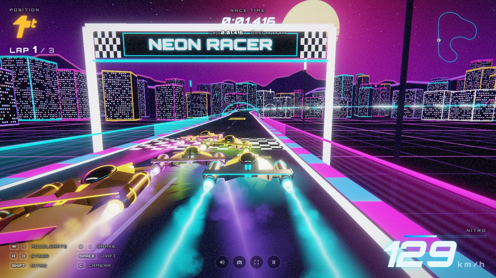

# NEON RACER

A fullscreen synthwave hover racer: three laps against five rivals on a floating neon circuit, with
vapour trails pouring off every engine. Built with three.js and WebGL in a single `index.html`.
There is no build step, and there are no image, model or audio assets.

霓虹赛车：全屏的合成器浪潮风格悬浮赛车游戏。在霓虹赛道上与五名对手比拼三圈，每台引擎都会拖出蒸汽尾迹。
单个 `index.html`，无需构建。



## Run it

Open `index.html` in a browser. Double-clicking it is enough, or serve the folder:

```sh
python3 -m http.server 8000     # or: npx serve .
```

three.js r187 is the only dependency and is loaded from a CDN. The loader tries four CDNs in turn
(npmmirror, esm.sh, unpkg, jsDelivr) and keeps the first that answers, so no single CDN being slow or
blocked can stop the game. The display font is embedded in `fonts.css`, and everything else (geometry, textures, audio) is
generated at start-up, so three.js is the only thing the game downloads.

## Controls

| Input | Action |
| --- | --- |
| `W` / `↑` | Accelerate |
| `S` / `↓` | Brake, then reverse |
| `A` `D` / `←` `→` | Steer |
| `Space` | Drift (hold while steering) |
| `Shift` | Nitro |
| `C` | Camera: chase, far chase, cockpit |
| `P` / `Esc` | Pause |
| `R` | Restart the race |
| `M`, `F` | Sound, fullscreen |
| `1` `2` `3` | Rival level: Rookie, Pro, Ace |
| Gamepad | Left stick steers, RT and LT are throttle and brake, A drifts, B or X fires nitro |
| Touch | On-screen arrows, with auto-throttle; Drift, Nitro and Brake buttons |

## The race

- You start from the back of a six-car grid. The energy barriers at the track edges are hard walls:
  grinding along one costs speed, and hitting one head-on costs a lot more.
- Drifting turns the car tighter than gripping alone and keeps more speed through a bend, and the
  slide charges the nitro gauge. A hard drift refills it in about a second and a half.
- Nitro gives about 2.5 seconds of boost, with a wider field of view and streaking highlights.
- Amber chevrons on the tarmac are boost pads: an instant kick, plus a top-up of nitro.
- Your best lap and best race time are kept in `localStorage`.

## How the vapour trails work

Each car carries four ribbon trails and two particle emitters, and both are rebuilt on the GPU every
frame:

- **Ribbons.** Every engine drops a point along its path as soon as it has moved far enough from the
  last one. Consecutive points become flat quads that are turned to face the camera in the vertex
  shader, with one shared side vector per segment. Each quad widens as it ages and fades over about
  three quarters of a second, so the trail is as long as the car is fast: a standing car leaves
  nothing, a car at top speed leaves a sixty-metre plume. The tail corners carry two more ribbons
  that only appear while the car is sliding.
- **Particles.** Engines shed vapour, the tail corners shed heavier smoke during a drift, and
  grinding a barrier throws sparks. Each particle's position is a closed-form function of its age,
  evaluated in the vertex shader, so the CPU only writes births into a ring buffer and never updates
  a live particle. The sprites come from a small noise-carved atlas drawn on a canvas at start-up.

The trails are additive over a half-float frame buffer, and only values above 1.0 bloom, so the
vapour glows without washing out the road.

## Under the hood

`index.html` is one module script in fourteen numbered sections:

| Section | Contents |
| --- | --- |
| 0 | Loader: three.js with CDN fallback; `?debug` flag |
| 1 | Helpers (smoothing, seeded random, time formatting, safe storage) |
| 2 | The circuit: a closed Catmull-Rom spline sampled into a lookup table, the road, kerbs, energy barriers, arches, boost pads and their shaders |
| 3 | Sky with a striped sun, grid floor, mountain ridges, an instanced skyline with procedural windows |
| 4 | Post-processing: HDR target with MSAA, a four-level bloom, ACES tone mapping, chromatic aberration, grain, nitro streaks |
| 5 | The car: a hull lofted from cross-sections, engine pods, canopy, wings, engine flames |
| 6 | Vapour trails and particles |
| 7 | Handling, rivals, contact between cars |
| 8 | Race logic: states, laps, timing, classification |
| 9 | Cameras: chase, cockpit, the attract race, the grid sweep, the finish orbit |
| 10 | HUD, minimap and screens |
| 11 | Audio: engine, wind, tyres, impacts and a scheduled synthwave loop, all synthesised |
| 12 | Input: keyboard, touch and gamepad |
| 13 | Main loop and adaptive resolution |

A few things worth knowing:

- **Handling is expressed as budgets.** The nose may only turn as fast as a lateral-acceleration
  budget allows, velocity swings round to follow it at a finite rate, and that swing redirects momentum
  rather than destroying it. Cornering therefore costs an explicit amount of speed, and the feel is
  the same at any frame rate. Physics runs in fixed substeps.
- **Rivals live in track coordinates** (distance along the circuit, offset across it). They brake
  for the tightest bend ahead, aim for the inside of the next corner, pull out for traffic, and are
  kept near the player by bounded, gentle rubber-banding.
- **The post pipeline is hand-written** from render targets and full-screen passes, so the game needs
  three.js core and no add-ons.
- **Resolution adapts to the machine.** It starts at or below about six megapixels and steps down if
  frames run long.
- **Animation frames are not assumed.** If a view never delivers them, a 60 Hz timer takes over, so
  the game still runs in embedded previews.

## Tinkering

Open the page with `?debug` to get a `window.__neon` handle: the scene, camera, renderer, track, game
state and racers, plus `hold()` and `render()` for stable screenshots and `simulate(seconds)` to
fast-forward without drawing. Without the flag none of this exists.

## Credits

- [three.js](https://threejs.org) r187, MIT licence.
- [Orbitron](https://github.com/theleagueof/orbitron), Copyright 2018 The Orbitron Project Authors,
  SIL Open Font Licence 1.1; the latin subset of weights 700 and 900 is embedded in `fonts.css`.
