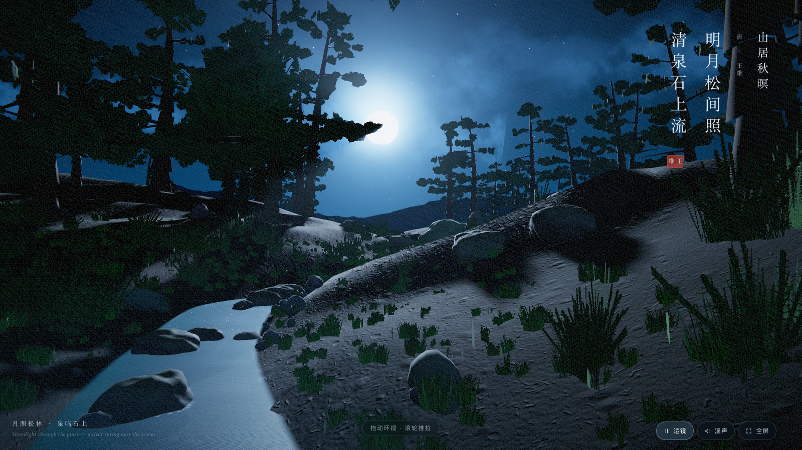

# 明月松间照 · 清泉石上流

**王维《山居秋暝》的三维诗境** · three.js r170 · WebGL 2 · 单文件、无外部资源

> 明月松间照，清泉石上流。
>
> *The bright moon shines between the pines; the clear spring flows over the stones.*



夜山、松影、月光和一条贴着石头流过的溪涧，全部在浏览器里实时渲染。没有图片、模型或音频
文件：地形、松树、石头、水面、月色、星云和声音都在打开页面时程序化生成。

## 运行

直接双击 `index.html` 即可。three.js 已经内联在页面里，所以断网也能打开；用 `file://`
打开同样可用。若想通过本地服务器访问：

```sh
python3 -m http.server 8000
# 打开 http://localhost:8000
```

页面没有构建步骤，也没有任何运行时网络请求。

## 操作

| 输入 | 动作 |
| --- | --- |
| 拖动画面 / 单指滑动 | 环视四周 |
| 滚轮 / 双指捏合 | 推近、拉远 |
| 双击画面 或 `C` | 暂停 / 恢复电影运镜（也可以点右下角的「运镜」） |
| `M` 或「溪声」按钮 | 开启 / 静音程序化合成的溪流与松风 |
| `F` 或「全屏」按钮 | 全屏 |
| `H` | 隐藏 / 显示诗句与控件 |
| `R` | 回到溪流的起点 |

打开时镜头会沿着水面缓缓上溯，再绕回来，全程约 132 秒。任何时候拖动画面都会接管镜头，
点「运镜」或按 `C` 会平滑地回到电影镜头。

## 场景里有什么

- **松林。** 58 棵程序化松树：每棵有自己的种子、弯曲的树干、层叠的长枝和外形不同的针叶束。
  树干和枝条是 3,595 段实例化锥台，针叶是 11,993 张实例化卡片（三张手绘针叶贴图随机分配），
  全部只占几次 draw call。风经过树冠时，针叶会轻轻摆动。
- **溪涧。** 一条 Catmull-Rom 样条从远处山坳流下，沿途有四处小跌水。地形是围绕这条样条
  “挖”出来的：河床、湿岸、长苔的缓坡、被树根和碎石打断的林地和远山。水是沿着样条生成的
  带状网格，宽度随水流忽宽忽窄。
- **石头。** 河心和岸边散布着大小不一的石头、卵石和几根倒木；靠近水线的部分颜色更深，
  朝上的面覆着苔藓，河心的石头边缘有一圈白水。
- **月光。** 一盏带阴影的平行光代表月光，外加半球光、补光和细小的水光。月晕、薄云、
  星子、远山和一层很淡的雾把松林推远。
- **空气。** 月光经过树冠时会出现体积光（屏幕空间光线），溪面上有缓慢漂移的雾气，
  光束里浮着尘埃，跌水处飞着水沫，偶尔有松针落下。
- **水面着色。** 三层不同方向的波纹法线沿溪流滚动；菲涅尔反射天空与月晕；一条被涟漪
  打碎的月光路径；石头周围的白色水花和河岸的细碎泡沫；最后与雾色混合。
- **后期。** 自写的 HDR 管线：半浮点缓冲、桌面端 4× MSAA、三级 bloom、屏幕空间月光、
  ACES 色调映射、冷暖分离调色、暗角、颗粒和一点点色差。没有使用任何后期插件。
- **声音。** 用 WebAudio 滤波噪声合成：溪流是带通/低通后的噪声，松风是更低的频段，
  再用几个极慢的 LFO 让它们呼吸。默认静音，点「溪声」后淡入。

## 技术

`index.html` 里是一个按编号分段的模块脚本：

| 段 | 内容 |
| --- | --- |
| 0 | 工具、噪声、随机数、渲染器、相机、自写 HDR / bloom / 光线后期 |
| 1 | 程序化纹理：月亮、针叶、树皮、石头、地面、水面法线、蕨、草、云、泡沫 |
| 2 | 天空、星、月、云、远山、灯光 |
| 3 | 溪流样条、地形、水面 shader、石头、卵石、倒木 |
| 4 | 松树生成与实例化、林下蕨草、倒木、镜头路径的避让 |
| 5 | 月光体积光、雾气、尘埃、水沫、落针 |
| 6 | 电影镜头、输入、声音、界面、主循环 |

一些实现上的选择：

- **单文件、离线优先。** three.js r170（MIT）以内联的经典脚本形式放在文件末尾，ESM 的
  导出表被绑定到 `window.THREE`。因此 `file://`、断网、本地静态服务器都能运行。
- **一切皆程序化。** 26 张 canvas 纹理在启动时绘制（含法线贴图），没有下载任何资源。
- **森林用实例化。** 针叶卡片按三张贴图分成三个 `InstancedMesh`；树干、枝条、草、蕨、
  卵石也都是实例化网格。总实例数约 25,000。
- **阴影只做该做的。** 桌面端开启 2048² 阴影，覆盖整条溪谷；移动端关闭阴影、减少树木
  和草木数量，并把 DPR 限制在 1.45。
- **自适应分辨率。** 启动 150 帧后若平均帧时间超过 26 ms，会分级降低渲染分辨率；
  隐藏页面时声音淡出。
- **手机竖屏。** 相机纵向视野会根据画幅扩到 76°，让月亮、松林和溪水都能进入竖屏。

### 调试

在 URL 后加 `?debug` 会暴露 `window.__poem`（`scene`、`camera`、`renderer` 等），并提供：

```js
__poem.pause();                 // 冻结时间与镜头
__poem.seek(0.12);              // 跳到电影镜头的 12%
__poem.setTime(3.5);            // 设置水/风/雾的时间
__poem.setView(px,py,pz, tx,ty,tz); // 指定相机与视线
__poem.render();                // 渲染一帧
```

不加 `?debug` 时不会留下任何全局对象。

## 兼容性

- 需要 WebGL 2（Chrome / Edge / Firefox / Safari 的近期版本都支持）。
- 桌面端建议独立显卡或较新的集成显卡；页面会自动调整分辨率。
- 触屏设备：单指环视、双指缩放；界面会自动收起为图标。
- 首次打开会有一个短暂的“铺开月色”载入画面，等待程序化纹理和松林生成。

## 许可与致谢

- 诗句：王维《山居秋暝》，公有领域。
- [three.js](https://threejs.org) r170，MIT 许可；完整许可见
  [THIRD_PARTY_NOTICES.md](THIRD_PARTY_NOTICES.md)。
- 页面、shader、程序化纹理与声音合成代码为本项目原创，沿用仓库的 MIT 许可。
- 字体使用系统自带的宋体 / 苹方 / Georgia，没有内嵌字体文件。
