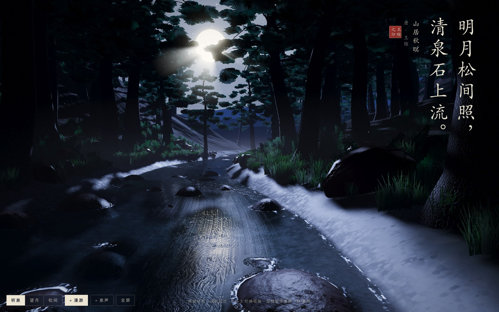

# 明月松间照 · 清泉石上流

A moonlit pine valley with a stream running over stones: the moon low in the gap between the pines
upstream, its light coming down between them in shafts, and clear water with the bed showing through.
Built with three.js and WebGL in a single `index.html`. There is no build step, and there are no
image, model or audio assets.

王维《山居秋暝》「明月松间照，清泉石上流」的三维意境：月悬松间，光束斜落，清泉漫过溪石，水底
卵石清晰可见。单个 `index.html`，无需构建；所有贴图、几何体和声音都在启动时生成。



## Run it

Open `index.html` in a browser. Double-clicking it is enough, or serve the folder:

```sh
python3 -m http.server 8000     # or: npx serve .
```

three.js r187 is the only dependency and is loaded from a CDN. The loader tries four CDNs in turn
(npmmirror, esm.sh, unpkg, jsDelivr) and keeps the first that answers, so no single CDN being slow or
blocked can stop the scene. Everything else is generated at start-up, in a second or so,
so three.js is the only thing the page downloads.

## Controls

| Input | Action |
| --- | --- |
| Drag | Look around |
| Wheel, or pinch | Closer or further |
| `1` `2` `3` | 听泉 · 望月 · 松间 |
| `Space` | Pause or resume the slow wander |
| `M` | Sound of the stream on or off |
| `F` | Fullscreen |

The three views:

- **听泉** (spring) stands in the stream and looks upstream at the moon.
- **望月** (moon) looks up along the moonlight, through the crown of the pine the moon rests on.
- **松间** (pines) perches above the water and looks down the stream as it winds away through the pines.

Left alone for a few seconds, the view starts to wander very slowly. Any input stops it, and the
wander is switched off altogether when the system asks for reduced motion.

## How the scene is made

- **The valley is one height function.** Given a position, it returns the height of the channel, the
  gravel banks, the slopes rising on either side, and every stone in the stream as a rounded dome. It
  is sampled once into a dense grid along the stream, and that grid drives two things: the terrain
  mesh, and a texture the water reads to learn how deep it is and whether the bed below is stone.
- **The water knows the bed.** Each frame the solid scene is drawn once more at half resolution, and
  the water bends a copy of that image through its surface and tints it with depth, so the pebbles
  and the sunken stones are the real bed seen through moving water. Foam is laid wherever the water
  thins against a stone or the bank, and where it churns over a stony riffle; stones that break the
  surface leave a wake. The reflection of the sky and the pines comes from a cubemap of the scene,
  captured once at start-up.
- **Moonlight** is one directional light with shadows, plus that cubemap for everything wet. The
  shadows of the pines fall across the stream, and the moon's glints appear on the water only where
  the surface is lit.
- **The pines are grown, not modelled.** Each tree is a leaning trunk, whorls of branches that flatten
  and droop as they age, and sprays of needles along the outer part of every branch. A spray is eight
  cards at random orientations, lit as one small volume. Trees near the view are built in full;
  further away the whorls, the sprays and the ring segments of the wood thin out together.
- **The moon shafts** are a post-process. From each pixel the shader marches towards the moon's place
  on screen and gathers the bright sky that is still visible along the way. The pines only occlude,
  so what comes out is light streaming between them, and only below the moon.

## Under the hood

`index.html` is one module script in twelve numbered sections:

| Section | Contents |
| --- | --- |
| 0 | Loader: three.js with CDN fallback |
| 1 | Helpers, noise, and every procedural texture |
| 2 | The valley: centre line, bed, stones, the dense height grid |
| 3 | Sky: moon, halos, stars, cloud, and the ridges that close the valley |
| 4 | Terrain mesh and its material |
| 5 | Water: depth lookup, refraction, reflection, glints, foam |
| 6 | Pines, grass, ferns and bank boulders |
| 7 | Mist on the water, motes, leaves on the current |
| 8 | Moonlight, sky bounce, fog, and the cubemap |
| 9 | Post-processing: HDR and MSAA, bloom, moon shafts, tone mapping and grade |
| 10 | Camera, the three views, input |
| 11 | Sound of the stream, UI, resolution, main loop |

A few things worth knowing:

- **It needs three.js core only.** The post pipeline, the camera and the shadows are written by hand
  from render targets and shader chunks, so nothing is imported from `three/addons` and the CDN
  fallback can stay simple.
- **Nothing that casts a shadow moves**, so the shadow map is drawn once and reused.
- **Resolution adapts to the machine.** It starts at or below about 2.6 megapixels and steps down if
  frames run long, and back up when they do not.
- **Animation frames are not assumed.** If the browser never delivers them, a timer keeps the scene
  running, so it still moves in embedded previews.
- **The scene is the same on every visit.** Everything procedural is seeded.

On an Apple M5 it holds 60 fps at 2.6 megapixels, with about 1.1 million triangles in the main pass
and 0.9 million in the extra pass for the water.

## Tinkering

| URL parameter | Effect |
| --- | --- |
| `?view=spring` `moon` `pines` | Which view the scene opens in |
| `?still` | Freeze the clock, for stable screenshots |
| `?t=30` | Where the clock starts, in seconds |
| `?scale=0.5` | Fix the render scale, and stop it adapting |
| `?debug` | Expose `window.__moon` |

With `?debug`, `window.__moon` holds the scene, camera, renderer, lights and post-processing uniforms,
along with `setView(name)`, `freeze(on)` to hold the camera while you move it by hand, and `stats()`.
Without the flag none of this exists.

## Credits

- [three.js](https://threejs.org) r187, MIT licence.
- 明月松间照，清泉石上流 — 王维《山居秋暝》.
